# 案例：與 AI 共編 MMSE／CDR 語音訪談表單

> 2026-10-23 以本 plugin 實際完成的一張表單，從安裝、需求訪談、建置、runtime 驗證、上架，到改版與提示詞優化。截圖 01–08 依當天操作紀錄重建（帳密已省略）；10–13 是院內版表單在本機 runtime 預覽的實際截圖（離線、不呼叫 AI、無病人資料）。

## 目標

一張失智症門診用的表單：

- 提問卡逐題提示 MMSE 11 題（問病人）與 CDR 6 項（問家屬）。
- 一鍵錄音、轉文字，逐字稿自動標上【題名】。
- AI 先整理證據、再逐題給分；不確定的題目留給人手動選。
- 總分、教育程度切點、CDR 自動總評（Morris 規則）、SOB、報告結果句由計算式完成，醫師最後確認。

## 1. 安裝與連線

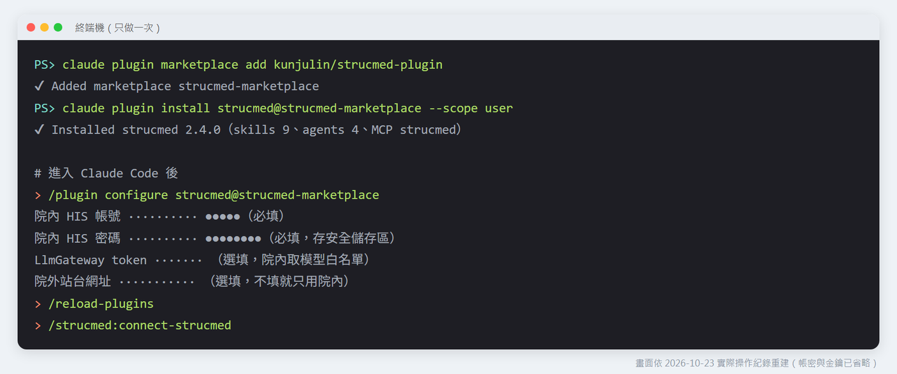

安裝步驟見 [README](../README.md#安裝)。密碼用 `/plugin configure` 填，不在對話中輸入；站台由 MCP 自動判斷院內或院外。

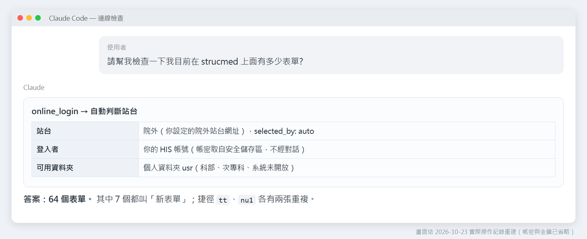

連線後可以直接用中文問「我有多少張表單」，plugin 以唯讀的 `online_folder_list` 回答，順便指出名稱或捷徑重複的表單。

## 2. 需求訪談

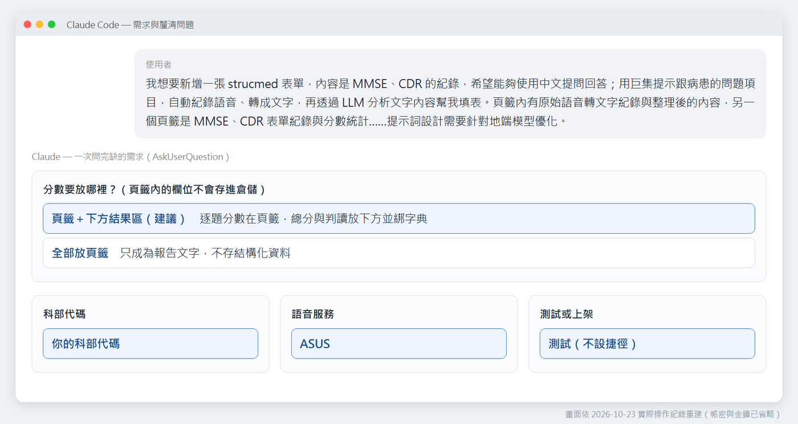

用一段話描述需求，`create-form` 會用 `AskUserQuestion` 一次問完缺的資訊：

| 問題 | 為什麼要問 |
|---|---|
| 分數放哪裡 | 頁籤內的欄位不回倉儲、不能綁字典（L6） |
| 科部代碼 | 決定能沿用哪些既有字典 |
| 語音服務 | `VOICETOTEXT` 只接受 `'ASUS'` 或 `'QWEN'` |
| 測試或上架 | 有捷徑＋作業別＝存檔即上架 |

## 3. 工作流與閘門

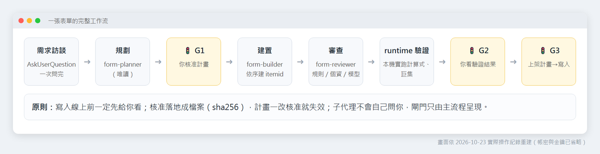

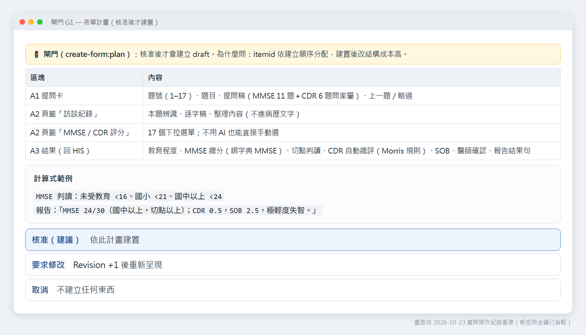

G1 列出區塊、欄位、計算式與 AI 資料流；核准後 `verify-plan.mjs prepare` 存成 sidecar，計畫一改核准就失效。這個案例的 G1 前後改了 4 版（例如按鈕的 `action_id` 不能指向 numberbox、說明分數欄位放在頁籤要宣告偏離 L6）。

## 4. 成品


每一列是「說明｜對應按鈕」：換題、錄音並辨識、AI 整理、AI 評分、核對、醫師確認。

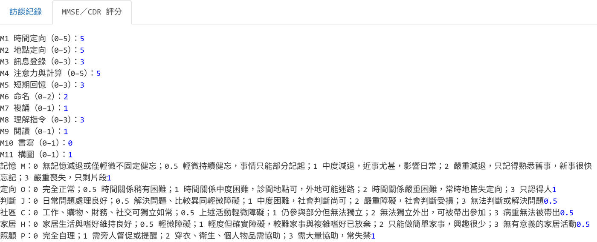

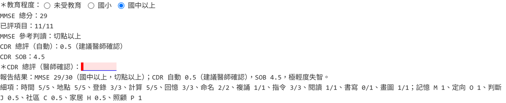

## 5. G2 runtime 驗證：一定要實跑

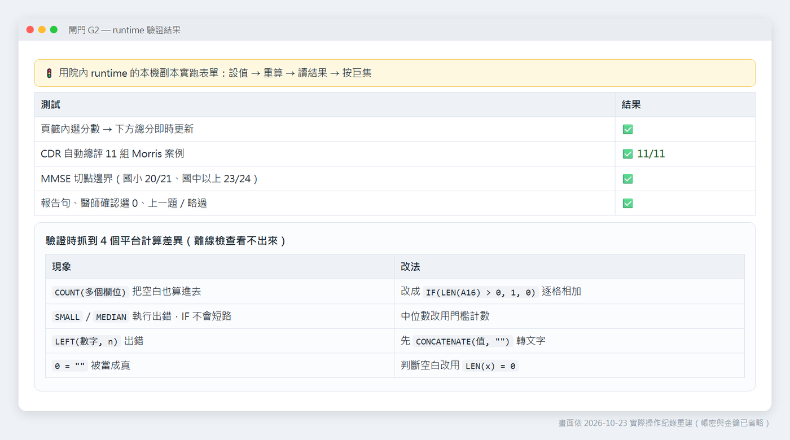

`formula_check` 全部通過，實跑仍抓到 4 個平台計算差異：

| 現象 | 改法 |
|---|---|
| `COUNT(多個參照)` 把空白算進去 | `IF(LEN(A16) > 0, 1, 0)` 逐格相加 |
| `SMALL`／`MEDIAN` 執行出錯，且 `IF` 不短路 | 中位數改用門檻計數：`IF(K(0) >= 3, 0, IF(K(0.5) >= 3, 0.5, …))` |
| `LEFT(數字, n)` 出錯 | `LEFT(CONCATENATE(值, ""), n)` |
| `0 = ""` 為真 | 判斷空白改用 `LEN(x) = 0` |

驗證用已知答案的案例：CDR 11 組（含 M＝0、0.5、1 與 3／2 分邊）、MMSE 切點邊界（國小 20／21、國中以上 23／24）。

## 6. G3 上架

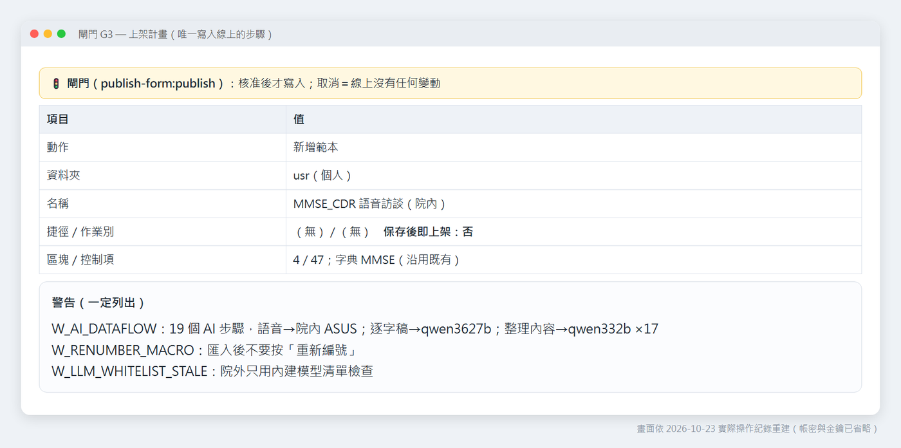

先放個人資料夾、不設捷徑；更新原範本用 `online_template_update`（If-Match）。改版時若重建按鈕，itemid 會變，使用者在編輯器人工貼過的巨集也會跟著舊按鈕消失，計畫要先說清楚。

## 7. 提示詞優化（地端模型）

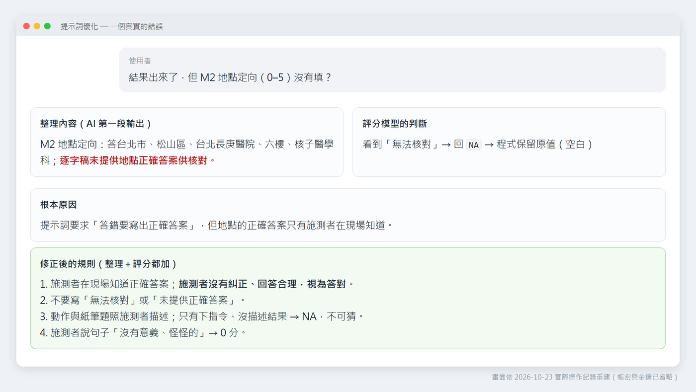

真實錯誤：整理內容寫了「逐字稿未提供地點正確答案供核對」，評分模型因此回 `NA`。原因是 prompt 要求「寫出正確答案」，但地點的正確答案只有施測者在現場知道。修正：施測者沒有糾正、回答合理時視為答對；不准寫「無法核對」。

| # | 做法 | 為什麼 |
|---|---|---|
| 1 | 兩段式：先整理證據一次，再逐題評分 17 次 | 小模型一次只做一件事最穩 |
| 2 | 逐字稿每題自動加【題名】 | 模型不用自己切段 |
| 3 | 計分規則寫進 prompt | 不靠模型記憶 MMSE／CDR |
| 4 | 開頭講一次、結尾再提醒，以「答案：」結尾 | 小模型容易忘記前面的指令 |
| 5 | 不知道就輸出 NA | 不讓模型猜分數 |
| 6 | 回覆先驗證，不是允許值就不填 | 擋下「5。」「NA」「0.5（MMSE）」 |
| 7 | 確定性的事不給 LLM | 總分、切點、CDR 總評用計算式 |
| 8 | 防呆、不帶識別資料 | 資料太少不呼叫；不送病歷號與姓名 |

院內版「AI 評分」的每一題是三個巨集步驟：

```text
LLMQUERY(<回覆欄>, IF(LEN(<整理內容>) < 20, "NA", CONCATENATE("<該題規則>", <整理內容>, "。再提醒：只輸出一個數字或 NA。答案：")), "qwen332b"),
MACRO(<題目>, IF(OR(TRIM(<回覆欄>) = "0", …), TRIM(<回覆欄>), <題目原值>)),
MACRO(<未給分欄>, CONCATENATE(<未給分欄>, IF(OR(…), "", " <題號>")))
```

`ISNUMBER` 在 runtime 不存在，允許值驗證改用 `OR(... = "...")`。

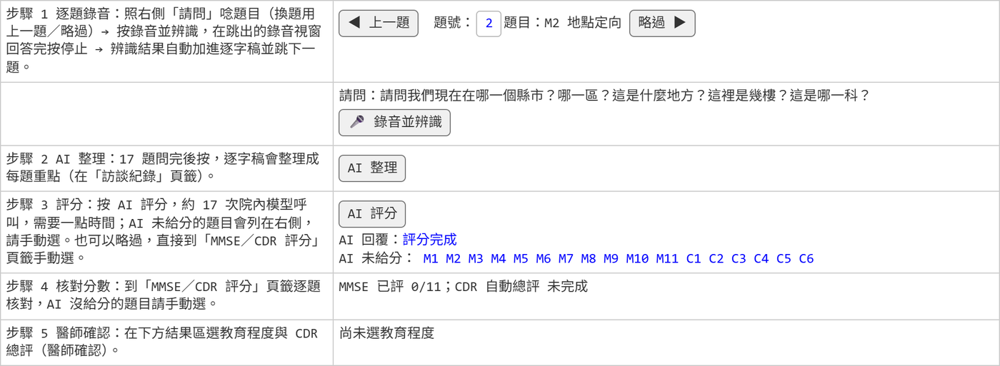

離線預覽不會真的呼叫 AI，所以 17 題都列進「AI 未給分」，原本選好的分數保留。

## 8. 院內版與雲端版

| | 雲端版（測試） | 院內版 |
|---|---|---|
| 語音 | OpenAI 相容 API | 院內 ASUS（`VOICETOTEXT`） |
| LLM | 表單 JS＋`CUSTOMFUNC` | 院內模型（`LLMQUERY`） |
| 巨集 | plugin 不產生 `CUSTOMFUNC`，需人工貼上並審查 | plugin 自動產生 |
| 金鑰 | 使用者瀏覽器 | 不需要 |
| 資料 | 送院外，需院方同意 | 不出院 |

plugin 刻意不產生 `CUSTOMFUNC` 與表單 JS（[SecurityInvariants](../references/SecurityInvariants.md) §5）：表單 JS 能執行任意程式，必須由人審查後才放進表單。能用平台內建函數就用內建。

## 9. 這次學到的

- 計畫先行：itemid 依建立順序分配，結構改動的成本在建置後才顯現。
- 驗證要實跑：語法檢查看不出平台與 Excel 的差異。
- 提示詞要和現場一致：先問「這個資訊，逐字稿裡真的有嗎？」
- 不確定就留給人：AI 給建議，醫師做決定。
